 

 

<table>
  <tr>
    <td width="33%" valign="top">
      <code>◆ NOW</code> 
      <strong>Backend Engineering Intern @ FlyRank AI</strong> 
      Building my software engineering skills through APIs, data, and practical backend work.
    </td>
    <td width="33%" valign="top">
      <code>◆ I LIKE SOLVING</code> 
      <strong>Messy → maintainable</strong> 
      Turning repetitive tasks into automations, fuzzy requirements into clean systems, and ideas into software people actually use.
    </td>
    <td width="33%" valign="top">
      <code>◆ OFF-TERMINAL</code> 
      <strong>Student leader</strong> 
      Leadership roles alongside my studies taught me to communicate clearly, coordinate people, and stay steady under pressure.
    </td>
  </tr>
</table>

  
<strong>♡ tiny personal lore</strong>

   

  - I care about the details: good UX, clean structure, and documentation that makes sense.
  - Current interests: backend systems, databases, security, cloud workflows, and applied AI.
  - Personal motto: *make it useful, make it clear, then give it a little personality.*

 

<table>
  <tr>
    <td width="50%" valign="top">
      <h3><a href="https://github.com/JudeaTablate/Second-Sense">◢ Second Sense</a></h3>
      Behavioral authentication and account-takeover detection using typing and mouse dynamics.  
      <code>FastAPI</code> <code>PostgreSQL</code> <code>Redis</code>
    </td>
    <td width="50%" valign="top">
      <h3><a href="https://github.com/JudeaTablate/flyrank-task-api">◢ FlyRank Task API</a></h3>
      Task REST API with CRUD endpoints, validation, persistent storage, and API docs.  
      <code>Python</code> <code>FastAPI</code> <code>SQLite</code>
    </td>
  </tr>
  <tr>
    <td width="50%" valign="top">
      <h3><a href="https://github.com/JudeaTablate/sentinel-uptime-monitor">◢ Sentinel Uptime Monitor</a></h3>
      Monitors service availability and surfaces issues that need attention.  
      <code>Monitoring</code> <code>Automation</code>
    </td>
    <td width="50%" valign="top">
      <h3><a href="https://github.com/JudeaTablate/cloud-auto-backup">◢ Automated Cloud Backup</a></h3>
      Automates file sync to Google Drive with Python and GitHub Actions.  
      <code>Python</code> <code>GitHub Actions</code>
    </td>
  </tr>
  <tr>
    <td width="50%" valign="top">
      <h3><a href="https://github.com/JudeaTablate/SplitBill">◢ SplitBill</a></h3>
      Real-time shared bill calculator with automatic tax and tip splitting.  
      <code>Node.js</code> <code>Express</code> <code>WebSockets</code>
    </td>
    <td width="50%" valign="top">
      <h3><a href="https://github.com/JudeaTablate/Wine-About-It">◢ Wine About It</a></h3>
      Interactive wine-learning experience with a 3D glass and AI-assisted discovery.  
      <code>React</code> <code>Vite</code> <code>GSAP</code>
    </td>
  </tr>
</table>

 

<table>
  <tr>
    <td width="22%"><code>LANGUAGES &amp; WEB</code></td>
    <td>
      
      
      
      
      
    </td>
  </tr>
  <tr>
    <td><code>BACKEND &amp; DATA</code></td>
    <td>
      
      
      
      
      
    </td>
  </tr>
  <tr>
    <td><code>TOOLS &amp; CLOUD</code></td>
    <td>
      
      
      
      
    </td>
  </tr>
</table>

 

| `◆` | Role | Organization | Period |
|:---:|:---|:---|:---|
| ◆ | **Backend Engineer Intern** | FlyRank AI | `AUG 2026 → NOW` |
| ◇ | **Executive Secretary** | Student Coordinating Council, FEU Tech | `AUG 2024 → JUL 2025` |
| ◇ | **Associate Director for Logistics** | Association for Computing Machinery | `AUG 2024 → JUL 2025` |

  
<strong>✦ certifications &amp; learning</strong>

   

  | Certification | Issuer |
  |:---|:---|
  | AI Agents &amp; Python Machine Learning | TestDome |
  | IT Specialist — Python | Pearson |
  | Preparing for Your Associate Cloud Engineer Journey | DataCamp |
  | Getting Started with Cisco Packet Tracer | Cisco Networking Academy |
  | PMI Project Management Ready | Project Management Institute |
  | Foundation Course on IP and New Product Development | IPOPHL |

 

  
  
  

 

  
    
  <a href="https://judeatablate.vercel.app/">Portfolio</a> &nbsp;✦&nbsp;
  <a href="https://www.linkedin.com/in/judea-ann-tablate-65a8901b7/">LinkedIn</a> &nbsp;✦&nbsp;
  <a href="mailto:judeaannctablate@gmail.com">Email</a>

